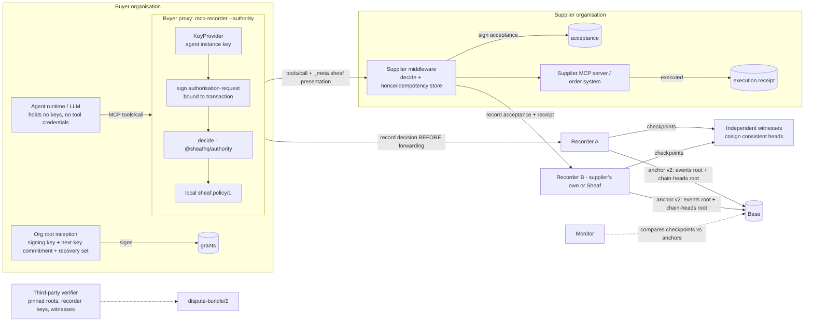

# Sheaf Authority Protocol (SAP): architecture

**Status: Revision 2. Phase 1 approved in principle; this revision adds the
owner's six requirements (2026-11-17). Nothing here is implemented yet.**
No application code changes are made as part of this design.

"SAP" is a working name.

### What changed in revision 2

| # | Owner requirement | Where it's addressed |
|---|---|---|
| 1 | Transaction-bound authorisation, supplier acceptance, explicit replay protection | §6, §5.4–5.8, §14 |
| 2 | Separate routine rotation, emergency recovery and identity revocation | §8, §5.1–5.2 |
| 3 | Recorder transparency: split-view detection, witnesses; precise receive-receipt semantics | §10 |
| 4 | Selective disclosure must never hide authority-relevant restrictions | §11 |
| 5 | Local signing bug as a separate, immediate fix with regression tests | §13 |
| 6 | Authority mode opt-in and fail-closed; standard recording unchanged | §3.3 |

The rest of the document is revision 1, updated where these changes reach it.

---

## 0. Summary

Sheaf records **what** agents did (hash-chained, recorder-signed,
Merkle-anchored events) and can block calls against a static policy. It
cannot yet prove **who** acted or **whether they were allowed to**:

- `event.actor` is an unauthenticated string.
- Evidence-document signatures verify against a key **embedded in the
  document**, so there is no identity binding.
- Delegations are checked for structure only: no attenuation, depth, expiry or
  revocation.
- There is no revocation.
- Local mode signs principal documents with the **recorder's** key. This is a
  security bug, now tracked separately as S1 (§13).

SAP adds four separate layers, **identity, authority, enforcement and
evidence**, with the smallest design that closes those gaps:

1. **Self-certifying identities** whose key history is an append-only log. Each
   has a **pre-committed next key** (routine rotation) and a **k-of-n recovery
   set** (emergency recovery), so a stolen signing key can neither rotate nor
   revoke the identity.
2. **One grant format** for mandates and delegations, with UCAN semantics in
   Sheaf's JCS + Ed25519 convention and a closed caveat vocabulary in which
   every caveat has an attenuation rule.
3. **Transaction-bound authorisation.** Every purchase is a signed request bound
   to buyer, agent, supplier, exact transaction terms, amount, currency,
   transaction hash, grant chain, expiry and nonce. It produces **four
   separately signed artefacts**: agent request → buyer authority decision →
   supplier acceptance → supplier execution receipt.
4. **One pure, deterministic Authority Engine** (`@sheafhq/authority`), run by
   the buyer's firewall, by the supplier, and again by any verifier.
5. **Revocation as Sheaf events** on small per-tree chains, proven by
   contiguous ranges up to **witnessed checkpoints**.
6. **Recorder transparency.** Checkpoints are cosigned by independent witnesses,
   and every anchored epoch commits to **exactly one head per chain**, so a
   recorder that shows different histories to different parties is detectable
   from Base itself.
7. **Authority mode is opt-in and fail-closed.** Standard recording is
   byte-for-byte unchanged.

The central conclusion is unchanged: **the supplier's independent
verification is the only control a compromised buyer cannot bypass.** It is
mandatory in v1.

---

## 1. Assessment of the current architecture

Canonical tree: the production copy
(`the Windows working copy`, uncommitted on
top of GitHub `main`; see `AGENTS.md`). Baseline 50/50 tests pass (disclose 19,
evidence 9, disclosures 3, dispute 11, authoring 3, policy 4, local 1). The
browser and s3-gateway suites were not run.

### 1.1 Implemented (code + tests)

| Component | Where | Notes |
|---|---|---|
| `arca/1` envelope, JCS, SHA-256 | `src/canonical.ts`, `src/chain.ts` | Recorder signs `JCS({v,event,chain})`; leaf = `sha256(JCS({v,event,chain}))`. **`signatures` is excluded from both.** |
| Hosted recorder | `src/index.ts` `POST /events` | Shape validation only; chain ownership by API key. `signatures.actor` is stored, never verified. `result` may be `blocked`. |
| Merkle epochs + Base anchoring | `src/merkle.ts`, `src/anchor.ts`, cron every 15 min | Calldata `ARCA‖epoch‖root` (44 bytes). An epoch commits to a *set* of events, **not** to per-chain heads. |
| Pinned trust | `packages/verify/src/trust.ts`, `trust/*.json` | Fail-closed; never fetches `public_key_url`. |
| Selective disclosure | `src/disclose.ts`, `packages/verify/src/disclosures.ts` | Contiguous ranges, boundary refs, cross-epoch proofs. Envelope-level only. |
| Evidence documents | `schemas/sheaf.{mandate,delegation,consent}-document-1`, `src/evidence.ts` | `inputs_hash = sha256(JCS(doc − document_signature))`. Signature optional, **key self-asserted**, and `key_id` is **not** hashed. |
| `event.kind` | additive on `arca/1` | The precedent SAP follows. |
| Dispute bundle v1 | `src/dispute.ts`, `packages/verify/src/dispute.ts` | 14 granular checks + `evidence_gaps`. |
| `sheaf.policy/1` + firewall | `packages/{mcp-recorder,verify}/src/policy.ts`, `enforce.ts` | ALLOW / BLOCK / REQUIRE_APPROVAL; engine **duplicated** in two packages. |
| MCP stdio proxy | `packages/mcp-recorder/src/proxy.ts` | One event per allowed call, written after the response; fail-open recording. |
| Local mode | `packages/mcp-recorder/src/local.ts`, `src/local.ts` | Local Ed25519 ledger; plaintext PKCS#8 key file (0600). |
| Browser verifier | `dispute-verify.html` | Single file, WebCrypto Ed25519. SAP verification must run here too. |

### 1.2 Partial or experimental

- REQUIRE_APPROVAL has no approval flow; it behaves like BLOCK (`-32002`).
- Delegation verification checks linkage only.
- `signatures.actor` is never produced, never verified, and not committed by
  the leaf.
- Local-mode document signing uses the recorder key as the principal's (§13).
- Thin tests where SAP builds (policy 4, local 1).

### 1.3 Described in docs but not implemented

- ARCHITECTURE.md's `SheafAnchor` contract. Real anchoring is a self-transfer
  with tagged calldata. Docs to be corrected.
- "Historical receipts verify against the key active at their `ts`".
  `ts` is client-supplied.
- "Actor signature verified via an external identity registry". There is
  none, by design.

### 1.4 Reuse / extend / new

| Reuse as-is | Extend | New |
|---|---|---|
| JCS, SHA-256, Ed25519 (WebCrypto + node:crypto) | Evidence-document binding for new schemas | `@sheafhq/authority`: pure schemas, attenuation, chain + transaction verification, `decide()` |
| Hash chains, recorder signature, Merkle, anchoring | `event.kind` vocabulary | Identity, key-event, grant, transaction, request, decision, acceptance, receipt, approval, revocation schemas |
| Selective disclosure | Pinned trust store: + root inceptions, + witness keys | KeyProvider; supplier middleware with nonce/idempotency store |
| `sheaf.policy/1` constraint ops (reused as caveats) | `enforce.ts` (authority first, then policy) | Checkpoints, witness cosigning, receive receipts, anchor v2 (heads commitment) |
| `formatDisputeVerification` pattern | Dispute bundle v2 | Monitor tool (split-view detection) |

### 1.5 Security conflicts SAP must not inherit

1. **Recorder-made principal signatures.** Fixed separately and first (§13).
2. **Self-asserted document keys.** SAP resolves keys only through identity
   logs from pinned roots, and ignores inline keys.
3. **Signer not hashed.** In SAP documents `signer` is inside the hashed body.
4. **Uncommitted `signatures.actor`.** SAP never relies on it.
5. **Fail-open recording.** Authority mode records the decision *before*
   forwarding, and fails closed.
6. **Client-chosen time.** SAP bounds time with receive receipts, checkpoints
   and anchors (§10.3).
7. **Duplicated policy engine.** It moves into `@sheafhq/authority`.

### 1.6 Breaking-change risks

| Change | Breaking? | Mitigation |
|---|---|---|
| New `event.kind` values | No | Keep `arca/1`; golden fixtures |
| New document schemas | No | Legacy v1 docs stay readable as *identity-unbound* |
| Dispute bundle `authority` section | Yes for old verifiers | `sheaf.dispute-bundle/2`; verifier reads v1 + v2 |
| Anchor v2 (heads commitment) | Yes for old verifiers *of new anchors* | New magic (`SHF2`); v1 anchors still verify; v1 verifiers reject v2 anchors fail-closed |
| Fail-closed behaviour | Opt-in only | Only under `--authority` (§3.3) |
| S1 local signing fix | Changes `prepareLocalCase` output; downgrades old claims | Old bundles still pass integrity checks; authorisation reported as recorder-attested (§13) |
| New recorder endpoints | No | Additive; existing endpoints byte-identical |

### 1.7 Dependencies to avoid

- JSON-LD / VC data-integrity suites.
- On-chain identity registries.
- WASM policy engines in the browser verifier (unless D1 changes).
- JOSE/JWT (`alg` agility).
- Threshold-signature crypto libraries in v1 (§8.3 uses k-of-n independent
  Ed25519 signatures).
- **Any LLM in the decision path.**

---

## 2. What SAP can and cannot prove

| Objective | Provable? | Under which assumption |
|---|---|---|
| 1 Agent identity | Yes: the instance key signed the request | Key custody |
| 2 Owner/operator | Yes, **up to a pinned root inception**; legal identity is bound out of band | The relying party pins the right root |
| 3 Who authorised | Yes: root grant signature | Same |
| 4 What was granted | Yes: signed, fully disclosed grants (§11) | — |
| 5 Valid at action time | Yes, against **bounded** time (§10.3) | Recorder/witness honesty for lower bounds |
| 6 Delegation happened | Only recorded or presented delegations | Unpresented delegations authorise nothing |
| 7 Delegation legitimate | Yes: signatures, attenuation, depth, validity, revocation | — |
| 8 Permitted / blocked / approval | Yes: signed buyer decision, re-derivable | Same engine version |
| 9a Supplier verified and accepted | Yes: **supplier-signed acceptance** | Supplier key custody |
| 9b Actually executed | **Only as the supplier's signed claim** (execution receipt). An MCP response never counts. | Supplier honesty (attributable, not preventable) |
| 10 Evidence unaltered | Yes: chain, recorder sig, Merkle, anchor | Pinned recorder keys + anchorers |
| 11 Same history for everyone | **Detectable**, not preventable, unless witness quorum is required at decision time (§10) | Witness independence |

**SAP cannot prove:**

- absence of unrecorded actions (only per-supplier completeness, §14);
- real-world execution, beyond the supplier's signed word;
- legal identity from keys;
- that authorised actions were wise;
- current revocation state offline (only "as of a witnessed checkpoint").

---

## 3. Architecture

### 3.1 Layers

```
IDENTITY     who is acting?          sheaf.identity/1, sheaf.key-event/1
AUTHORITY    who allowed what?       sheaf.grant/1 (mandate | delegation), sheaf.revocation/1
ENFORCEMENT  is THIS transaction ok? sheaf.transaction/1 → sheaf.authorisation-request/1 → decide()
                                     → sheaf.authority-decision/1 (buyer) → sheaf.approval/1
                                     → sheaf.supplier-acceptance/1 (supplier)
EVIDENCE     can a third party check? arca/1 events, chains, Merkle, anchor v2, checkpoints + witnesses,
                                      receive receipts, sheaf.execution-receipt/1, dispute-bundle/2
```

Invariants, enforced by construction and checked by the verifier:

- Identity ⇏ authority: `decide()` requires a grant chain.
- Authority ⇏ delegation: requires `delegation.allowed` and depth budget > 0.
- Decision ⇏ acceptance: the supplier re-verifies independently.
- Acceptance ⇏ execution: only a separate execution receipt claims execution.
- MCP response ⇏ anything beyond "the supplier's server returned these bytes".

### 3.2 Components and dependencies



```
@sheafhq/authority   NEW, pure: no I/O, no clock, no deps (Node, Workers, browser)
  ▲      ▲        ▲
  │      │        └── @sheafhq/verify (bundle v2, report, monitor checks)
  │      └─────────── supplier middleware (@sheafhq/mcp-recorder export)
  └────────────────── @sheafhq/mcp-recorder (--authority, KeyProvider, presentation)
Worker (src/): checkpoints, receive receipts, anchor v2, witness endpoints; new kinds pass through
```

### 3.3 Implementation boundaries (owner requirement 6)

- **Opt-in.** Authority behaviour exists only under
  `sheaf-mcp-recorder --authority …`, under the supplier middleware, and on new
  Worker endpoints. Nothing changes for `--wrap`, `--local`, `--policy`, or
  plain `POST /events`.
- **Fail-closed in authority mode.** Any of the following ⇒ the call is **not
  forwarded**:
  - missing or invalid documents;
  - a stale or unwitnessed checkpoint where policy requires one;
  - failure to record the decision;
  - KeyProvider failure;
  - an engine error.

  The only non-BLOCK fallback is REQUIRE_APPROVAL, and only where the
  operator's policy allows it for low risk. Never ALLOW.
- **Compatibility guarantees, each with a test (§17):**
  - the `arca/1` signing input and leaf hash are unchanged;
  - existing endpoints are byte-identical in request and response;
  - v1 anchors and bundles verify unchanged;
  - all existing test suites pass unmodified;
  - the existing `--policy` firewall semantics are unchanged.

---

## 4. Standards evaluated

| Option | Verdict |
|---|---|
| Macaroons | Rejected: HMAC; third parties can't verify. |
| **Biscuit** | Strongest off-the-shelf capability token. Not chosen for v1 (WASM/Datalog in the browser verifier, bearer by default, less readable in disputes). Remains the alternative under D1. |
| **UCAN** | Semantics adopted (issuer/audience/capabilities/proof chain); wire format not, since the spec is in flux. |
| W3C VC / DID | Not in v1 (JSON-LD). `did:web`/DNS usable as *advisory* root-binding evidence. |
| **KERI** | **Ideas adopted:** self-certifying IDs; **pre-rotation** (next-key digest committed in advance); key events in an append-only log; witnesses. The full protocol is not adopted. |
| **C2SP signed-note / tlog-checkpoint / tlog-cosignature** (Sigstore, Go sumdb, Armored Witness) | **Adopt the formats for checkpoints and witness cosignatures (T1)**, so third-party witness software can be reused instead of building our own. Our per-chain logs are hash chains, so consistency proofs are chain segments (§10). |
| Certificate Transparency (RFC 9162) | Model for split-view detection; Base anchors + witnesses play the gossip role. |
| FROST / threshold Ed25519 | Deferred. v1 recovery uses k-of-n **independent** Ed25519 signatures: simpler, auditable, no new crypto. |
| HTTP idempotency keys (IETF draft) | Model for supplier-side exactly-once execution (§6.4). |
| OAuth RAR / Token Exchange | Rejected: online, bearer, server-centric. |
| SD-JWT / BBS+ | Not in v1; constrained by §11 if ever added. |

---

## 5. Data schemas (proposed)

Conventions for every SAP document:

- Strict JSON Schema, `additionalProperties: false`.
- `doc_hash = sha256(JCS(doc − "signature" − "signatures"))`.
- `ref = "sha256:" + doc_hash`. The recording event's `inputs_hash = ref`.
- **`signer` / `signers` live in the hashed body**; signature bytes are excluded.
- Ed25519 over the 32 raw bytes of `doc_hash`. No inline public keys.
- Times are RFC 3339 UTC. Amounts are integer **minor units** using the ISO 4217
  exponent, plus currency. No FX anywhere.

### 5.1 `sheaf.identity/1` (inception)

```json
{
  "schema": "sheaf.identity/1",
  "type": "organisation | human | agent | service",
  "handle": "org:acme",
  "display_name": "ACME Ltd purchasing org",
  "controller": null,
  "keys":     [ { "key_id": "s1", "alg": "Ed25519", "public_key": "b64" } ],
  "next_key_digest": "sha256:<sha256 of the next signing public key>",
  "recovery": {
    "threshold": 2,
    "keys": [ { "key_id": "r1", "alg": "Ed25519", "public_key": "b64" },
              { "key_id": "r2", "alg": "Ed25519", "public_key": "b64" },
              { "key_id": "r3", "alg": "Ed25519", "public_key": "b64" } ]
  },
  "created_at": "2026-11-17T10:00:00Z",
  "nonce": "b64-16",
  "signers": [ { "key_id": "s1" } ],
  "signatures": [ "b64" ]
}
```

- Identity ID `sid:<doc_hash>`. It is self-certifying and commits to the
  initial key, the next-key digest **and** the recovery set.
- **Roots** (`controller: null`) are self-signed by their signing key **and**
  ≥ `threshold` recovery keys, proving possession of the recovery set at
  inception. `next_key_digest` and `recovery` are **required for roots**.
- **Non-roots** (agents, services, humans under an org) have
  `controller: <sid>`, are signed by the controller's current signing key, and
  carry no recovery set. Their controller *is* their recovery path.
- `handle` is an untrusted label.

### 5.2 `sheaf.key-event/1`

```json
{
  "schema": "sheaf.key-event/1",
  "identity": "sid:…",
  "sn": 3,
  "prior": "sha256:<previous key-event or inception ref>",
  "event": "rotate | recover | revoke_identity | add_key | retire_key",
  "new_keys": [ { "key_id": "s2", "alg": "Ed25519", "public_key": "b64" } ],
  "next_key_digest": "sha256:…",
  "new_recovery": null,
  "compromised_since": null,
  "effective_at": "2026-12-01T00:00:00Z",
  "reason": "routine | compromise | decommission | policy",
  "signers": [ { "key_id": "s2" } ],
  "signatures": [ "b64" ]
}
```

- `sn` and `prior` form a strict per-identity sequence. Two events with the same
  `sn` are a **fork**, detected as `KEY_EVENT_FORK` (§8.5).
- The signing rules per event type are in §8.

### 5.3 `sheaf.grant/1` (mandate = root grant, delegation = derived)

As in revision 1. `grant_type`, issuer, audience, `parent` ref, capabilities
with the closed caveat vocabulary, delegation `{allowed, max_depth}`,
`approvers`, validity, `issued_at`, nonce, `signer` (in body), signature.
`signer.identity == issuer.identity`; for a delegation, issuer == the parent's
audience.

**Attenuation rules** (child ⊆ parent; an over-claim is rejected, never clamped):

| Caveat | Child ⊆ parent iff |
|---|---|
| `resource` (exact or trailing `/*`) | parent pattern matches child pattern |
| `abilities` | subset |
| `amount_max_minor` + `currency` | same currency and child ≤ parent |
| `counterparties` (supplier `sid`s) | subset; **required** for amount-bearing abilities |
| `approval_above_minor` | child ≤ parent |
| `constraints` (`sheaf.policy/1` objects, on the **transaction** object) | child ⊇ parent (canonical equality) |
| `validity` | child window ⊆ parent window |
| `delegation` | parent allowed and child depth ≤ parent depth − 1 |
| `approvers` | subset |

Excluded from v1: cumulative budgets (D7).

### 5.4 `sheaf.transaction/1` (exact transaction terms)

```json
{
  "schema": "sheaf.transaction/1",
  "buyer":    "sid:acme",
  "agent":    "sid:purchasing-eu1",
  "supplier": "sid:supplier-co",
  "resource": "mcp://supplier.example/purchase",
  "ability":  "invoke",
  "terms": {
    "items": [ { "sku": "LAPTOP-14", "qty": 1, "unit_minor": 50000 } ],
    "amount_minor": 50000,
    "currency": "EUR",
    "amount_includes": ["tax", "shipping"],
    "quote_ref": "sha256:<supplier-signed quote, optional>",
    "buyer_reference": "PO-2026-0042"
  },
  "arguments_hash": "sha256:<JCS of the MCP tool arguments>",
  "nonce": "b64-32"
}
```

- `transaction_hash = "sha256:" + doc_hash`. This is the identity of the
  transaction across all four artefacts.
- `amount_minor` is the **total the buyer can be charged**. `amount_includes`
  makes that explicit (T5).
- `arguments_hash` binds the exact MCP call. The supplier middleware checks that
  the received arguments hash equals it, so the agent cannot get one transaction
  approved and send different arguments.
- `quote_ref` (optional in v1, T6) binds a supplier-signed offer, so the buyer
  can prove the terms were the supplier's.

### 5.5 `sheaf.authorisation-request/1` (agent request)

```json
{
  "schema": "sheaf.authorisation-request/1",
  "request_id": "b64-16",
  "transaction": { "…": "full sheaf.transaction/1 object" },
  "transaction_hash": "sha256:…",
  "proof": ["sha256:<leaf grant>", "…", "sha256:<mandate>"],
  "audience": "sid:supplier-co",
  "issued_at": "2026-11-17T11:00:00Z",
  "expires_at": "2026-11-17T11:05:00Z",
  "freshness": { "checkpoint_ref": "sha256:<latest witnessed checkpoint seen>" },
  "signer": { "identity": "sid:purchasing-eu1", "key_id": "k1" },
  "signature": "b64"
}
```

- Signed by the buyer proxy's KeyProvider. The LLM never sees the key.
- `transaction_hash` must equal the hash of the embedded `transaction`.
- `transaction.agent == signer.identity`, and `transaction.supplier == audience`.
- `expires_at − issued_at ≤ 300 s` (configurable, never above 15 min).
- `freshness.checkpoint_ref` gives a **lower bound on creation time**: the
  request cannot predate the checkpoint it cites (§10.3).

### 5.6 `sheaf.authority-decision/1` (buyer enforcement point)

As in revision 1, plus `transaction_hash`. Fields:

- `request_ref`, `transaction_hash`, `chain`;
- `inputs`: identity/key-event refs, **witnessed** checkpoint refs, policy hash,
  engine version, `evaluated_at`;
- `decision` + `reasons`;
- `signer` = the buyer proxy's **service identity**.

### 5.7 `sheaf.supplier-acceptance/1`

```json
{
  "schema": "sheaf.supplier-acceptance/1",
  "acceptance_id": "b64-16",
  "request_ref": "sha256:…",
  "transaction_hash": "sha256:…",
  "buyer_decision_ref": "sha256:… | null",
  "verdict": "ACCEPTED | REJECTED",
  "reasons": ["WITHIN_MANDATE"],
  "inputs": {
    "pinned_root": "sid:acme",
    "checkpoints": ["sha256:<witnessed checkpoint refs the supplier used>"],
    "engine": "@sheafhq/authority@1.0.0",
    "evaluated_at": "2026-11-17T11:00:03Z"
  },
  "execute_by": "2026-11-17T11:15:00Z",
  "signer": { "identity": "sid:supplier-co", "key_id": "sk1" },
  "signature": "b64"
}
```

The supplier's **independent** verification uses its own pinned roots,
checkpoints and replay store. `buyer_decision_ref` is informational: the
supplier does **not** rely on the buyer's decision. REJECTED acceptances are
also signed and returned, so a refusal is evidence too.

### 5.8 `sheaf.execution-receipt/1`

```json
{
  "schema": "sheaf.execution-receipt/1",
  "acceptance_ref": "sha256:…",
  "transaction_hash": "sha256:…",
  "outcome": "EXECUTED | FAILED | CANCELLED",
  "charged": { "amount_minor": 50000, "currency": "EUR" },
  "external_ref": "ORDER-88213",
  "executed_at": "2026-11-17T11:00:05Z",
  "signer": { "identity": "sid:supplier-co", "key_id": "sk1" },
  "signature": "b64"
}
```

`charged.amount_minor > transaction.terms.amount_minor` or a currency mismatch
⇒ the verifier reports `CHARGE_EXCEEDS_AUTHORISATION`. That is the supplier's
fault, and attributable to it.

### 5.9 Other documents

- **`sheaf.approval/1`:** `{request_ref, transaction_hash, approver: sid,
  approved, not_after, signer, signature}`. Single use, bound to the exact
  transaction.
- **`sheaf.revocation/1`:** `{target: {type: grant, ref}, reason,
  effective_at, signer, signature}`. Allowed for the grant's issuer or any
  ancestor's issuer. Identity revocation is a key event (§8.4).
- **`sheaf.quote/1`** (optional, T6): supplier-signed terms + expiry.
- **Checkpoints, cosignatures, receive receipts:** §10.

### 5.10 Event kinds (additive on `arca/1`)

| `event.kind` | Document | Chain | `event.authority` |
|---|---|---|---|
| `identity`, `key_event` | identity/1, key-event/1 | `sap-id:<sid>` | prior event ref |
| `mandate`, `delegation` *(existing kinds)* | grant/1 | `sap-tree:<mandate_ref>` | parent grant event |
| `revocation` | revocation/1 | the target's tree chain | target event |
| `authority_decision` | authority-decision/1 (request co-disclosed, committed via `request_ref`) | buyer execution chain | leaf grant event |
| `approval` | approval/1 | buyer execution chain | decision event |
| `tool_call` *(existing)* | MCP arguments (unchanged) | buyer execution chain | ALLOW decision event |
| `supplier_acceptance` | supplier-acceptance/1 | **supplier's** chain | null (external ref in doc) |
| `execution_receipt` | execution-receipt/1 | **supplier's** chain | acceptance event |
| `counterparty_document` | copy of an acceptance or receipt, received by the buyer | buyer execution chain | `tool_call` event |

`counterparty_document` is **cross-logging**. The supplier's signed acceptance
and receipt appear on *both* organisations' logs, which helps detect split
views (§10).

---

## 6. Transaction-bound authorisation (owner requirement 1)

### 6.1 The four artefacts and what each proves

| # | Artefact | Signed by | Proves | Does **not** prove |
|---|---|---|---|---|
| 1 | Authorisation request | Agent instance key | This agent asked for **this exact transaction**, under this chain, before `expires_at` | That it was authorised |
| 2 | Authority decision | Buyer enforcement point | The buyer's engine evaluated (1) and decided X, given the stated inputs | That the supplier agreed, or anything executed |
| 3 | Supplier acceptance | Supplier identity | The supplier **independently** verified (1) and committed to execute by `execute_by` (or refused) | That execution happened |
| 4 | Execution receipt | Supplier identity | The supplier **claims** it executed and charged X, referencing `external_ref` | Truth of the claim (attributable, not guaranteed) |
| — | MCP `tool_call` event | Recorder (A) | The supplier's MCP endpoint returned these bytes to the buyer proxy | **Anything** about execution. It is never a substitute for (4) |

### 6.2 Flow

```
agent (LLM) ── tools/call(args) ──► buyer proxy
  1. build transaction (terms, arguments_hash, nonce) → transaction_hash
  2. sign authorisation-request (KeyProvider)                       [artefact 1]
  3. decide() with witnessed checkpoints                            [artefact 2]
  4. RECORD authority_decision on Recorder A ── fail ⇒ do not forward
     BLOCK            → JSON-RPC -32001 to agent; END
     REQUIRE_APPROVAL → -32002 + decision_id; resume only with a valid approval
     ALLOW            → forward tools/call with _meta.sheaf = {request, proof docs, decision}
supplier middleware
  5. replay + idempotency check (6.4)
  6. verify request independently: decide() with ITS pinned roots + checkpoints
  7. check received arguments hash == transaction.arguments_hash
  8. sign supplier-acceptance (ACCEPTED/REJECTED); RECORD on Recorder B  [artefact 3]
     REJECTED → return the acceptance in the error; nothing executed
  9. execute in the order system
 10. sign execution-receipt; RECORD on Recorder B                   [artefact 4]
 11. MCP response carries {acceptance, receipt} in _meta.sheaf
buyer proxy
 12. RECORD tool_call (authority = decision) + counterparty_document copies (cross-log)
```

### 6.3 What the supplier verifies (in order, fail-closed)

1. Request schema, signature and agent identity, via the identity log from the
   **supplier's** pinned buyer root.
2. Transaction hash and arguments hash.
3. `audience == self`; `transaction.supplier == self`.
4. Expiry window and replay store (§6.4).
5. Grant chain, attenuation, validity, revocation (witnessed checkpoints within
   the supplier's freshness bound).
6. Transaction against the leaf capability: resource, ability, amount ≤ cap,
   currency, `counterparties ∋ self`, constraints on the transaction object.
7. Approval if over `approval_above_minor`.
8. The supplier's own local policy, if any.

### 6.4 Replay protection

| Replay | Defence |
|---|---|
| Same request re-sent to the same supplier | Supplier **durable** consumed-request store keyed by `(agent sid, request_id)` and by `transaction_hash`, retained until `expires_at + max_skew`. A duplicate is **idempotent**: it returns the original acceptance/receipt and **never executes twice**. |
| Same request sent to another supplier | `audience` and `transaction.supplier` must equal the verifier's own `sid` |
| Old request after a long delay | `expires_at` (≤ 5 min default) checked against the supplier clock ± `max_skew` (≤ 30 s) |
| Re-using a decision for different terms | Decision, approval and acceptance all bind `transaction_hash` and `request_ref` |
| Re-using an approval | Approval binds `request_ref` + `transaction_hash`; single use is enforced by the supplier store |
| Request pre-signed and held back | `freshness.checkpoint_ref` bounds creation from below; `expires_at` bounds use from above |
| Supplier loses its replay store | The store records a **store epoch**. After any loss or restart without durable state, the supplier rejects requests with `issued_at < store_epoch_start`, fail-closed |
| Supplier double-executes | Two receipts for one `transaction_hash` are detectable (`DUPLICATE_EXECUTION`), attributable to the supplier |
| Buyer-side replay (agent loops) | The buyer proxy keeps its own seen-ID cache; it is convenience only. **Correctness relies on the supplier store** |

Legitimate retries (network failure after execution) are safe by design:
re-sending the same request returns the same signed receipt. That is
exactly-once semantics by idempotency key = `transaction_hash`.

---

## 7. Authority Engine and the verification algorithm

### 7.1 Contract

```ts
decide(input: {
  role: "buyer" | "supplier";
  request: AuthorisationRequest;
  documents: Map<Ref, SapDocument>;            // grants, identities, key events, revocations, approvals
  roots: PinnedRootInception[];                // the relying party's own pins
  checkpoints: WitnessedCheckpoint[];
  witness_policy: { keys: WitnessKey[]; quorum: number };
  policy: PolicyDocument | null;
  self: Sid | null;                            // the supplier's sid when role = supplier
  now: string;
  limits: { max_skew_s: number; max_checkpoint_age_s: number; risk: "low" | "high" };
}): { decision: "ALLOW" | "BLOCK" | "REQUIRE_APPROVAL"; reasons: Reason[]; effective: Capability | null }
```

It is pure and deterministic, with no I/O. The replay store is the
**caller's** responsibility (stateful), and is kept outside `decide()` on
purpose. That keeps the engine reproducible.

### 7.2 Algorithm

Each step's first failure is reported; all steps are reported.

```
1. IDENTITY RESOLUTION
   resolveKey(sid, key_id, at): walk the identity log from a pinned root inception (§8),
   verify every key event's signers and sequence, apply rotation/recovery/revocation,
   return the key valid at `at`                       → UNKNOWN_IDENTITY / KEY_NOT_VALID / KEY_EVENT_FORK / IDENTITY_REVOKED

2. REQUEST
   schema; signature under resolveKey(signer, issued_at); transaction_hash matches;
   agent == signer; supplier == audience; (supplier role) audience == self;
   issued_at − skew ≤ now ≤ expires_at; freshness checkpoint is known and not after issued_at
                                                       → INVALID_SIGNATURE / TRANSACTION_MISMATCH /
                                                         WRONG_AUDIENCE / REQUEST_EXPIRED / REQUEST_PREDATES_FRESHNESS
3. CHAIN (root → leaf)
   per grant: schema; ref; signer == issuer; signature under resolveKey(issuer, issued_at);
   root: mandate, parent null, issuer resolves from a pinned root;
   else: parent == prev ref, issuer == prev.audience, prev allows delegation, depth ok,
   attenuates(g, prev), validity ⊆ prev, issued_at within prev validity
                                                       → INVALID_SIGNATURE / UNTRUSTED_ROOT / INVALID_DELEGATION /
                                                         DELEGATION_NOT_PERMITTED / DEPTH_EXCEEDED / EXCEEDED_AUTHORITY
   leaf.audience == request agent                      → AUDIENCE_MISMATCH
4. VALIDITY: every grant valid at bounded action time    → EXPIRED_MANDATE
5. REVOCATION: per tree and identity chain, a checkpoint cosigned by ≥ quorum pinned witnesses,
   age ≤ bound, contiguous range with no applicable revocation
                                                       → REVOKED_AUTHORITY / UNVERIFIED_REVOCATION_STATE
6. TRANSACTION vs LEAF CAPABILITY: resource, ability, supplier ∈ counterparties,
   amount ≤ cap, currency equal, constraints hold on the transaction object
                                                       → EXCEEDED_AUTHORITY
7. APPROVAL: if amount > approval_above_minor: a valid approval for (request_ref, transaction_hash)
   from an effective approver, else                    → REQUIRE_APPROVAL
8. LOCAL POLICY: final = most_restrictive(authority, policy); BLOCK > REQUIRE_APPROVAL > ALLOW
9. FAIL-CLOSED: any step unverifiable (missing doc, stale or unwitnessed checkpoint) ⇒
   high risk: BLOCK; low risk: REQUIRE_APPROVAL only if policy permits. Never ALLOW.
```

The verifier re-runs `decide()` for the buyer decision (`role: buyer`) and the
supplier acceptance (`role: supplier`, `self` = supplier `sid`). A mismatch is
`DECISION_NOT_REPRODUCIBLE` or `ACCEPTANCE_NOT_REPRODUCIBLE`.

---

## 8. Key lifecycle (owner requirement 2)

Three separate mechanisms, with different signers.

### 8.1 Summary

| Mechanism | Event | Must be signed by | Who can do it if the signing key is stolen? |
|---|---|---|---|
| **Routine root rotation** | `rotate` | The **pre-committed next key** (its public key must hash to the current `next_key_digest`), which also commits a new `next_key_digest` | Not the thief: the next key is held separately, offline |
| **Emergency root recovery** | `recover` | ≥ `threshold` **recovery keys** | Not the thief, unless they also hold ≥ threshold recovery keys |
| **Identity revocation (root)** | `revoke_identity` | ≥ `threshold` recovery keys | Not the thief. This prevents a thief from permanently destroying the identity |
| Identity revocation (non-root) | `revoke_identity` | The controller's current signing key | — |
| Non-root key rotation / compromise | `rotate` / `recover` | The controller's current signing key | — |
| Add / retire auxiliary key | `add_key` / `retire_key` | The current signing key | A thief could add a key, but `recover` invalidates everything the thief did after `compromised_since` (§8.3) |

### 8.2 Routine rotation (pre-rotation)

1. The root holds signing key `S_n` (online or KMS) and next key `S_{n+1}`
   (offline). The log commits `H(S_{n+1}.public)`.
2. `rotate` reveals `S_{n+1}.public`. The verifier checks that it matches the
   committed digest and that the event is signed by `S_{n+1}`. The event commits
   a fresh `next_key_digest` for `S_{n+2}`.
3. Signatures by `S_n` made before `effective_at` stay valid. Historical
   verification is unaffected.

### 8.3 Emergency recovery after compromise

1. A `recover` event is signed by ≥ `threshold` recovery keys. It declares
   `compromised_since`, installs new signing key(s) and a new
   `next_key_digest`, and optionally a new recovery set.
2. **Effect on signatures by compromised keys:** a signature by a key compromised
   since `T` is valid only if the event recording it was **anchored (or
   witness-cosigned) before `T`**. Self-declared times can be forged by the
   thief; anchors and witness cosignatures cannot.
3. **Effect on documents:** grants signed by the compromised key that were
   *not* anchored or witnessed before `T` are invalid, even if the legitimate
   organisation made them. The organisation must re-issue them; we accept this
   cost.
4. **Race with the thief:** the thief cannot `rotate` (no next key) and cannot
   `recover` or `revoke_identity` (no recovery quorum). The thief *can* still
   sign grants with `S_n` until recovery is recorded. Those are invalidated
   by `compromised_since`, as long as recovery happens and `T` is set early enough.
   This window is unavoidable.
5. **If the recovery set itself is compromised (≥ threshold):** the identity
   cannot be saved. Relying parties must **re-pin a new root inception out of
   band**. We say so plainly; no protocol fixes this.

Recovery-set guidance (documented for operators, not enforced):

- 2-of-3 or 3-of-5.
- Keys held by different people or HSMs, in different locations, offline.
- Never on the agent host.

### 8.4 Identity revocation

- `revoke_identity` is **terminal**: no later key event is accepted.
- Every grant issued or received by the identity, and everything delegated from
  those grants, becomes invalid from `effective_at`, through structural
  propagation (§9). Historical signatures before `effective_at` stay verifiable
  as historical facts, and the report shows "identity revoked on T".
- Agents can be decommissioned by their controller at any time, which is the
  normal end of an agent instance.

### 8.5 How a verifier trusts a replacement key

- The relying party **pins the root's inception document** (its `sid`), not a
  bare key. This is a change from the pinned-recorder-key pattern.
- Any key reachable from that inception by a valid key-event log is trusted:
  - routine rotation, through the pre-committed digest;
  - recovery, through the recovery quorum committed at inception, or by a prior
    valid `new_recovery`.

  No re-pinning is needed for either.
- The key-event log lives on `sap-id:<sid>` and is covered by **witnessed
  checkpoints**. Two key events with the same `sn` are a fork, reported as
  `KEY_EVENT_FORK`. The verifier then trusts neither branch beyond the fork
  point unless a `recover` resolves it.
- **Freshness matters for key state too.** A verifier deciding *now* needs a
  recent witnessed checkpoint of the identity chain, or it reports
  `UNVERIFIED_KEY_STATE` (fail-closed for high-risk actions).

---

## 9. Revocation of grants

- Revocations are events on `sap-tree:<mandate_ref>`. Propagation is
  structural: verifying a grant verifies every ancestor.
- **Non-revocation proof** = a contiguous disclosed range of the tree chain from
  the grant's issuance to a **witnessed checkpoint** (§10). Contiguity proves
  nothing was omitted, so the absence of a revocation is proven **as of the
  checkpoint**.
- Per-tree chains keep ranges small and avoid revealing other trees.
- Freshness semantics (never silently stale):

| Situation | Report |
|---|---|
| Witnessed checkpoint within the bound after the action; no revocation | `REVOCATION VERIFIED as of <time> (k witnesses)` |
| Checkpoint stale or under quorum | `UNVERIFIED_REVOCATION_STATE`; the decision must have been BLOCK or REQUIRE_APPROVAL |
| Revocation recorded after the decision's checkpoint, effective before the action | `REVOKED_AUTHORITY` + `decision_used_stale_view` (the enforcement point acted within its stated bound) |
| Revocation recorded before the decision's checkpoint | `REVOKED_AUTHORITY` + `DECISION_NOT_REPRODUCIBLE` |

---

## 10. Recorder transparency (owner requirement 3; expands D11)

### 10.1 The problem

A signed checkpoint proves "the recorder said head = H". It does **not**
prevent the recorder from telling the buyer "head = H1 (no revocation)" and a
verifier "head = H2 (revocation)". That is a **split view**. Today's anchors
commit to a *set* of events per epoch. A recorder could include two
conflicting branches of the same chain in different epochs, and nobody would
notice unless they scanned every epoch.

### 10.2 Mechanisms (v1 builds the hooks and the first two; the network grows later)

1. **Anchor v2: one head per chain per epoch.** Each epoch anchors
   `root = H(events_root ‖ heads_root)`. `heads_root` is the Merkle root of the
   **sorted list** of `(chain_id, head_seq, head_hash)` for every chain touched
   in the epoch.
   - A chain therefore has **exactly one committed head per epoch**, on Base,
     visible to everyone.
   - Successive heads of one chain must form a hash-linked extension. That is
     checkable by anyone holding the intermediate events.
   - A split view now requires either two different heads for the same chain in
     one epoch (impossible in a sorted list with a proof of the neighbours), or
     a non-extending head in a later epoch. **Both are detectable from Base plus
     disclosed events.**
   - Calldata is a new format (`SHF2‖epoch‖root`). v1 anchors stay valid
     (T2 picks the exact structure).
2. **Witness cosignatures.** Checkpoints use the C2SP signed-note /
   tlog-checkpoint format (T1). A **witness** keeps, per chain, the last
   `(seq, head_hash)` it cosigned. It cosigns a new checkpoint only after
   checking consistency: the recorder supplies the linking events between the
   two seqs. Witnesses may be:
   - the counterparties themselves (the supplier is a natural witness for buyer
     authority chains it relies on);
   - independent third parties;
   - other Sheaf recorders (cross-logging, below).
3. **Witness policy at decision time.** The relying party sets
   `witness_policy = {keys, quorum}`:
   - `quorum ≥ 1` (with a witness the recorder doesn't control) makes split
     views **preventable** for that relying party, not just detectable: the
     recorder can't get two conflicting heads cosigned by an honest witness.
   - `quorum = 0` is allowed in v1 but reported as `CHECKPOINT_UNWITNESSED`.
     It is never silently accepted as equivalent.
4. **Cross-logging.** Supplier acceptances and receipts carry the checkpoints
   they relied on, and are recorded on the **supplier's** log *and* copied to
   the buyer's (`counterparty_document`). A dispute bundle containing both
   copies exposes any checkpoint conflict between the two organisations' views.
5. **Monitor** (`sheaf monitor`): a small tool that follows anchors,
   reconstructs heads per chain, and flags non-extensions, duplicate heads and
   checkpoints that contradict anchors. Anyone can run it; it needs only Base
   plus the recorder's public read endpoints.

**What v1 must ship vs accommodate:**

| Item | v1 | Later |
|---|---|---|
| Anchor v2 heads commitment | build | — |
| Checkpoint + cosignature formats | build | — |
| Witness API | build | — |
| Supplier-as-witness | build | — |
| Monitor CLI | build | — |
| Quorum enforcement in `decide()` | build | — |
| Independent public witness network, gossip, multi-recorder co-signing | — | accommodate (format-compatible) |

### 10.3 Receive-time receipts: what they prove, precisely

A receive receipt is
`{envelope_hash, chain_id, seq, received_at, recorder_key_id, sig}`, returned
by `POST /events`. It is additive; the `arca/1` signing input is unchanged.

| It proves | It does **not** prove |
|---|---|
| The holder of the recorder key **asserted** that it received an envelope with this hash and assigned it `(chain_id, seq)` | That the recorder's clock is correct, or that `received_at` is honest. The recorder can lie about time |
| If the recorder is honest, the event existed no later than `received_at` | That the event's content is true, or that its `event.ts` is accurate |
| The recorder committed to *this* seq for *this* hash (if it later shows a different event at that seq, the receipt is evidence of equivocation) | That the event is in the anchored log. Only a Merkle inclusion proof to an anchor proves that |
| | That no conflicting event received a receipt (split view). Only anchor v2 and witnesses address that |
| | A **lower** bound on when the event was created |

**Independent time bounds:**

- **Upper bound:** the anchor block timestamp. The event existed before the block,
  within Base's timestamp tolerance (seconds).
- **Lower bound:** a document that cites a checkpoint (`freshness.checkpoint_ref`)
  or a recent Base block hash was created **after** that checkpoint or block.
- **Witness cosignatures** add time evidence from parties other than the
  recorder: a witness's cosign time is an upper bound attested by someone else.

The verifier computes the **bounded action time** from these, and uses it for
expiry and revocation checks. The report shows the bounds and their sources.

---

## 11. Selective disclosure (owner requirement 4)

**Principle for v1: independently verifiable authority over maximum privacy.**
Anything `decide()` consumes must be fully disclosed to whoever has to verify
the decision.

| Document | Must disclose (fully) | Why | May withhold |
|---|---|---|---|
| Every grant in the presented chain | **All fields** | The signature covers the whole document; every caveat can change the decision; a hidden field could hide a restriction (e.g. a lower cap or an exclusion) | Grants **outside** the chain |
| Identity inceptions + key events on the path | All fields | Key validity, rotation, recovery and revocation are all decision inputs | Other identities' logs |
| Authorisation request + transaction | All fields | Amount, currency, supplier, terms and arguments hash are checked against caveats | MCP arguments beyond `arguments_hash`, **unless** a caveat constraint reads them (then the verifier reports `INCOMPLETE_EVIDENCE` unless disclosed) |
| Revocation range | All events in the range | Contiguity proves absence | Other trees; payloads of non-authority events (there are none on tree chains) |
| Checkpoints + cosignatures | All | Freshness and split-view evidence | — |
| Decision, acceptance, receipt, approval | All fields | Each is a signed claim checked field by field | — |

Rules:

1. **No field-level hiding of any SAP authority document in v1.**
   Signatures don't permit it, and it would allow hidden restrictions.
2. If field-level disclosure is ever added (D9, v2+), only **non-authority**
   fields may be committed-and-hidden: `display_name`, `handle`,
   `buyer_reference`, free-text notes. Never capabilities, caveats, validity,
   delegation, approvers, issuer, audience, parent, signer, keys, amounts,
   currency, supplier or terms. The schema will mark each field
   `authority-relevant: true | false`, and the verifier will refuse bundles that
   hide an authority-relevant field.
3. **Mitigating the privacy cost** without hiding:
   - issue **narrow, per-supplier** grants;
   - keep business detail in `terms.items` minimal, or reference it by hash
     (`quote_ref`), when no caveat reads it;
   - use per-tree chains.
4. Confidentiality vs integrity is reported separately. The report states what
   was verified from disclosed content and what is integrity-only (hash match
   without content).

---

## 12. Evidence integration, bundle v2 and the report

- `sheaf.dispute-bundle/2` = v1 + an `authority` section containing:
  - trust roots used (inception refs), witness policy;
  - identities + key events;
  - grants;
  - revocation ranges + witnessed checkpoints;
  - transactions, requests, decisions, approvals;
  - acceptances, receipts (from the supplier log and/or `counterparty_document`
    copies);
  - receive receipts.

  Every referenced event is disclosed with its Merkle proof and anchor (v1 or
  v2). `bundle_id` covers everything.
- **The report is granular.** One row per check, with a status of pass, fail,
  not_applicable or **unverified**, plus a code, *verified facts* and
  *assumptions*. Overall is the worst row: `VERIFIED` only if every applicable
  row passes and none is unverified.

| Group | Codes |
|---|---|
| Integrity (existing) | existing codes; `ANCHOR_HEADS_CONFLICT` (v2) |
| Transparency | `CHECKPOINT_UNWITNESSED`, `WITNESS_QUORUM_NOT_MET`, `SPLIT_VIEW_DETECTED` |
| Identity | `UNKNOWN_IDENTITY`, `UNTRUSTED_ROOT`, `KEY_NOT_VALID`, `KEY_EVENT_FORK`, `IDENTITY_REVOKED`, `UNVERIFIED_KEY_STATE`, `INVALID_SIGNATURE` |
| Authority | `INVALID_DELEGATION`, `DELEGATION_NOT_PERMITTED`, `DEPTH_EXCEEDED`, `EXCEEDED_AUTHORITY`, `EXPIRED_MANDATE`, `REVOKED_AUTHORITY`, `UNVERIFIED_REVOCATION_STATE` |
| Transaction | `TRANSACTION_MISMATCH`, `WRONG_AUDIENCE`, `REQUEST_EXPIRED`, `REQUEST_PREDATES_FRESHNESS` |
| Decisions | `DECISION_NOT_REPRODUCIBLE`, `ACCEPTANCE_NOT_REPRODUCIBLE`, `APPROVAL_INVALID` |
| Execution | `EXECUTED_WITHOUT_AUTHORITY`, `EXECUTED_WITHOUT_ACCEPTANCE`, `NO_EXECUTION_RECEIPT`, `CHARGE_EXCEEDS_AUTHORISATION`, `DUPLICATE_EXECUTION` |
| Legacy | `LEGACY_UNBOUND_EVIDENCE`, `RECORDER_SIGNED_NOT_PRINCIPAL` (§13) |
| Completeness | `INCOMPLETE_EVIDENCE` |

The printed summary separates the stages:
**requested → decided → accepted → executed (supplier's claim)**, each with its
signer and status.

---

## 13. S1: local signing security fix (owner requirement 5)

**A separate track.** It ships before any SAP work and doesn't depend on SAP
decisions.

> **Status (2026-11-17): implemented in the working tree; not yet committed,
> deployed or published.** See CHANGELOG "SECURITY (S1)".
>
> - §13.4 tests 1–9 are covered by `test/local-signing.test.mjs` (9/9) and
>   `test/browser.test.mjs`.
> - Security-review hardening is covered by `test/s1-review.test.mjs` (43/43):
>   key-material classification, strict Ed25519, and the authorisation tiers.
> - Totals: Node suites 102/102 (Node 22 and Node 24), browser 6/6 in Edge.
> - Isolated patch: `..\patches\0001-security-S1-*.patch`; SHA-256 in
>   `S1-SHA256SUMS.txt`.
> - The interim authorisation model (relying-party signer pins) is
>   documented in `packages/verify/README.md`. It is the bridge to SAP identity
>   (§5.1), not a replacement for it.
> - The audit (§13.2-3) found a second instance: the hosted bundle builder
>   inferred `principal_signature` from any signature. Fixed.
> - It also found an unrelated build-script bug: string `replace` with
>   `$`-patterns in `build-dispute-verifier.mjs`. Fixed.
> - **Pending:**
>   - deploy the rebuilt `/verify` page (live still runs the pre-fix verifier);
>   - publish `@sheafhq/verify` with the fix;
>   - commit and push.

### 13.1 The bug

`prepareLocalCase` (`src/local.ts`) signs the mandate, every delegation and the
consent with the **local recorder ledger key**. It then writes
`delegation.root.attestation = {basis: "principal_signature", key_id:
<ledger key>, …}`. The dispute verifier accepts the signature because it checks
documents only against their embedded key. The result: a recorder-generated
signature presented as the principal's authorisation.

### 13.2 Fix: code

1. `prepareLocalCase` **never signs** principal, issuer or consent documents.
   It keeps only signatures already present on the input documents. Without a
   principal signature:
   - the document stays unsigned;
   - `root.attestation.basis = "recorder_observed"`;
   - the verifier reports the existing `mandate_signature` /
     `delegation_signature` gaps.
2. A separate, explicit command, `sheaf local sign-document --key <principal key
   file | keystore ref>`, signs with a **principal-held** key. It **refuses**
   if the key's public key equals the ledger key (`SIGNING_KEY_IS_RECORDER_KEY`).
3. Audit every other code path that signs documents for the same pattern
   (`signEvidenceDocument` callers, authoring CLI, fixtures). Report the findings
   in the PR.

### 13.3 Fix: verifier (protects past evidence)

- If an evidence document's signature key equals **any recorder key known to the
  verification context**, it is classified `RECORDER_SIGNED_NOT_PRINCIPAL`:
  - the key embedded in the bundle's `recorder` block;
  - the local trust file's key;
  - any pinned recorder key.

  It counts as **unsigned** for authorisation (the gap is added; `complete:
  false`), and the check row explains why.
- A `root.attestation.basis` of `principal_signature` whose key equals a recorder
  key is **downgraded** to `recorder_observed` with the same code.
- **Historical evidence is preserved:** integrity checks (chain, Merkle, anchor,
  hashes) are unaffected, so old bundles remain `VALID` for integrity. Only the
  authorisation claim changes:
  `VALID (integrity) — authorisation: recorder-attested only`.
- Browser and CLI share the formatter, so both show the same downgrade.

### 13.4 Regression tests (S1 exit criteria)

| # | Test | Expected |
|---|---|---|
| 1 | `prepareLocalCase` on unsigned inputs | No output document has a signature by the ledger key; `basis == "recorder_observed"` |
| 2 | `prepareLocalCase` on principal-signed inputs | Original principal signatures preserved byte-identically |
| 3 | `sign-document` with the ledger key | Refused, `SIGNING_KEY_IS_RECORDER_KEY`, non-zero exit |
| 4 | `sign-document` with a distinct principal key | Signs; verifier accepts as principal-signed |
| 5 | **Legacy fixture** made by the pre-fix code (recorder-signed mandate + `principal_signature` basis) | Integrity valid; `RECORDER_SIGNED_NOT_PRINCIPAL`; `complete: false`; never "authorised by principal" |
| 6 | The same legacy bundle in the browser verifier | Byte-identical output to the CLI |
| 7 | Hosted-path walking fixtures (distinct principal key) | Unchanged results; no false positives |
| 8 | A document whose key equals a *pinned* recorder key (hosted) | `RECORDER_SIGNED_NOT_PRINCIPAL` |
| 9 | All existing suites | Pass unmodified, except intentional changes in local-case expectations, each listed in the PR |

---

## 14. Threat model

**M** = mitigation, **R** = residual risk.

| Threat | M | R |
|---|---|---|
| Prompt injection | Deterministic decisions over signed grants; the LLM holds no keys or tool credentials; approval thresholds | Harmful actions *inside* granted scope remain possible |
| Compromised agent process | Keys in KeyProvider; tool credentials only in the proxy; **supplier verifies independently** | — |
| Compromised buyer host | The supplier refuses anything without a valid chain, transaction binding and fresh witnessed checkpoints | The attacker can act **within** the instance's authority until revocation; the window is bounded by grant validity and freshness |
| Stolen agent key | Controller `recover` / `revoke_identity`; short grants; witnessed freshness | Window until revocation is recorded and witnessed |
| Stolen org signing key | Pre-rotation (the thief can't rotate); threshold `recover` (the thief can't recover or revoke); anchored-before-`compromised_since` rule | Grants signed by the thief before `compromised_since` is declared can verify until then. Choose `compromised_since` early; accept re-issuance |
| Recovery-set compromise (≥ threshold) | Operational separation of recovery keys | **Unrecoverable in-protocol.** Relying parties re-pin out of band |
| Forged delegation | Keys only via identity logs from pinned inceptions; no inline keys; signer hashed | A relying party pinning the wrong inception |
| Privilege escalation | Per-caveat attenuation, depth, holder-only delegation, strict over-claim rejection | Implementation bugs, addressed with property tests (§17) |
| **Transaction substitution** (approve A, execute B) | `transaction_hash` + `arguments_hash` bound in all four artefacts; the supplier checks the received arguments hash | A supplier that skips the check (detectable: the receipt references a transaction whose hash doesn't match the executed arguments) |
| Replay / double execution | §6.4: durable supplier store, idempotency by `transaction_hash`, audience, expiry, store epoch | A supplier with a non-durable store that ignores the store-epoch rule |
| Expired / revoked authority | Bounded time; witnessed checkpoints; fail-closed | The freshness window (explicit) |
| **Split view by the recorder** | Anchor v2 one-head-per-chain; witness quorum; cross-logging; monitor | With quorum 0, detection only after the fact |
| **Witness collusion** | Quorum across independent witnesses (incl. the supplier itself) | Colluding quorum. Choose witnesses with opposed incentives |
| Recorder withholds revocation | The revocation issuer gets a receive receipt; witnesses see the gap; the issuer can submit to a second recorder (cross-log) | Delay until someone checks |
| Recorder time lies | Receive receipts are labelled recorder-asserted; bounds come from anchors, witnesses and freshness refs | Within-bound skew |
| Malicious MCP server / response spoofing | An MCP response proves nothing about execution; only supplier-signed receipts count | — |
| Malicious supplier (false receipt, overcharge, double charge) | Every claim is signed and attributable; `CHARGE_EXCEEDS_AUTHORISATION`, `DUPLICATE_EXECUTION` | SAP attributes the lie; it doesn't prevent it |
| Buyer repudiation ("our agent wasn't authorised") | Root-signed grants + agent-signed request + supplier acceptance, all anchored | Disputes about the off-chain root binding |
| Buyer decision forged or skipped | The supplier re-verifies independently; the verifier re-runs the decision | — |
| Event omission | Per-tree contiguity; per-supplier completeness only if the supplier executes solely SAP-accepted requests and logs each | **No global completeness claim** |
| Downgrade (supplier accepts legacy unbound docs; verifier skips witnesses) | Legacy docs never satisfy SAP checks; quorum 0 is always reported | Operator misconfiguration (visible in the report) |
| Local-mode key theft | KeyProvider OS keystore by default; file keys need an explicit flag | Same-user malware |
| Recorder-made principal signatures | S1 code + verifier fix (§13) | Third-party tools copying the old pattern (detected by the verifier check) |

---

## 15. Trust assumptions (stated in every report)

1. The relying party's pinned **root inceptions** belong to the intended
   organisations (out of band).
2. Pinned **recorder keys**, **anchorers** and **witness keys**. For split-view
   *prevention*: at least one honest witness in the quorum.
3. Base finality and timestamp tolerance.
4. Recovery sets are not compromised beyond threshold.
5. Signing keys are uncompromised up to any recorded `compromised_since`.
6. The declared engine version. This is re-run, so it becomes a verified fact.
7. Execution claims are the **supplier's** signed word.
8. Recorder `received_at` is recorder-asserted only (§10.3).

---

## 16. Key custody

`KeyProvider { keyId(); publicKey(); sign(digest32) }`:

| Provider | When |
|---|---|
| `os-keystore` (DPAPI / Keychain / libsecret) | Default for agent instance and service keys |
| `file` (0600) | Dev only; explicit flag; loud warning |
| `kms` / `pkcs11` | Later |

Root signing keys should be offline or in KMS. **Next keys and recovery keys
are offline and held separately.** Issuing grants is a separate CLI process,
never inside an agent session.

---

## 17. Implementation sequence, dependencies and tests

### 17.1 Dependency graph

```
S1 local-signing fix ─────────────────────────────────────────────┐ (independent, FIRST)
P0 prereqs (commit+push, compat harness, single evaluatePolicy) ──┤
                                                                  ▼
P1 spec + golden vectors ──► P2 identity + key lifecycle ──► P3 grants + attenuation
            │                                                     │
            └──► P4 transparency (checkpoints, witnesses,         ▼
                  anchor v2, receive receipts, monitor) ──► P5 transaction + request + decide()
                                                    │             │
                                                    ▼             ▼
                                         P6 grant revocation ──► P7 buyer firewall (--authority)
                                                                  │
                                                                  ▼
                                                    P8 supplier middleware (acceptance, receipts, replay store)
                                                                  │
                                                                  ▼
                                                    P9 evidence kinds + bundle v2 + verifier report
                                                                  │
                                                                  ▼
                                                    P10 demo A/B/C + adversarial suite
```

P4 can run in parallel with P2–P3. No phase starts before its predecessors'
tests pass and their security notes are written.

### 17.2 Tests per stage (exit criteria)

**S1:** the nine tests in §13.4.

**P0: prerequisites**

- The existing 50 tests pass in a fresh clone of pushed `main`.
- **Compatibility harness:** golden `arca/1` envelopes (no `kind`, with `kind`),
  v1 bundle, v1 anchor calldata. Their hashes and signatures are frozen and
  asserted on every later phase.
- The single `evaluatePolicy`: the old recorder and verifier test vectors give
  identical results.

**P1: spec**

- JSON Schemas for every SAP document validate the golden vectors and reject
  each vector with one field removed or added.
- Cross-runtime vectors: identical JCS bytes, hashes and signatures in Node,
  Workers and the browser (WebCrypto).

**P2: identity and key lifecycle**

| Test | Expected |
|---|---|
| Root inception without recovery set or next digest | Rejected |
| Routine rotate signed by the committed next key | Accepted; the old key is valid before `effective_at` and invalid after |
| Rotate signed by the current key only (thief scenario) | `KEY_NOT_VALID` / rejected |
| Rotate revealing a key that doesn't match the digest | Rejected |
| `recover` with k−1 recovery signatures | Rejected |
| `recover` with k signatures | Accepted; signatures after `compromised_since` that weren't anchored before it are invalid; anchored-before ones are valid |
| `revoke_identity` by the signing key alone (root) | Rejected |
| `revoke_identity` by quorum; any later key event | Later event rejected (terminal) |
| Two key events with the same `sn` | `KEY_EVENT_FORK` |
| Non-root signed by a non-controller | Rejected |
| Inline `public_key` in a document | Ignored; resolution uses the log only |
| Identity log with a stale checkpoint (high risk) | `UNVERIFIED_KEY_STATE` ⇒ BLOCK |

**P3: grants and attenuation**

- Unit tests for every row of the attenuation table, in both directions.
- **Property-based tests** (≥ 10k random parent/child pairs): every accepted
  child satisfies a reference ⊆ oracle, and every over-claim is rejected.
- Adversarial matrix:
  - €2,000 from €1,000;
  - a capability absent from the parent;
  - delegate when not allowed;
  - depth + 1;
  - extended validity;
  - a non-holder delegates;
  - a currency change;
  - dropping a parent constraint;
  - adding a counterparty;
  - widening a resource pattern.

**P4: transparency**

| Test | Expected |
|---|---|
| Anchor v2 round-trip; v1 anchors still verify | Pass |
| Two heads for one chain in one epoch (crafted) | `ANCHOR_HEADS_CONFLICT` |
| Non-extending head across epochs | Monitor flags it |
| Witness asked to cosign an inconsistent checkpoint | Refuses |
| Consistent checkpoint | Cosigns |
| Quorum 0 | `CHECKPOINT_UNWITNESSED` (never VERIFIED) |
| Quorum k with k−1 cosignatures | `WITNESS_QUORUM_NOT_MET` |
| Receive receipt | Signature verifies; the report labels `received_at` recorder-asserted; a bound violation against the anchor time is flagged |
| Split-view simulation: recorder gives the buyer H1 and the verifier H2, both witnessed by different sets | Detected when either bundle meets anchor v2 or cross-logged copies |

**P5: transaction, request and `decide()`**

| Test | Expected |
|---|---|
| Transaction hash mismatch | `TRANSACTION_MISMATCH` |
| Wrong audience | `WRONG_AUDIENCE` |
| Expired request | `REQUEST_EXPIRED` |
| Request older than its cited freshness checkpoint | `REQUEST_PREDATES_FRESHNESS` |
| Amount over cap; wrong currency; supplier not in counterparties | `EXCEEDED_AUTHORITY` |
| Over approval threshold without approval | REQUIRE_APPROVAL |
| Over threshold with an approval for a different `transaction_hash` | Approval invalid |

Also:

- **Determinism:** 1,000 runs with shuffled document maps give identical output.
- `decide()` performs no I/O, enforced by a test that stubs `fetch`, `Date` and
  `fs` to throw.

**P6: grant revocation**

- Revoke a mandate ⇒ every descendant is `REVOKED_AUTHORITY`.
- Revoke a mid-chain delegation ⇒ only its subtree is affected.
- A revocation hidden by omitting a range event ⇒ contiguity fails.
- A stale checkpoint ⇒ `UNVERIFIED_REVOCATION_STATE` (never VERIFIED).
- A revocation after the decision's checkpoint ⇒ `decision_used_stale_view`.

**P7: buyer firewall (`--authority`)**

| Test | Expected |
|---|---|
| BLOCK / REQUIRE_APPROVAL | Never reach the server (stderr probe, as in the existing tests) |
| Recorder down | Not forwarded |
| KeyProvider failure | Not forwarded |
| Engine exception | Not forwarded |
| Standard modes (`--wrap`, `--policy`, `--local`) | Byte-identical behaviour to pre-SAP golden transcripts |
| Arguments changed after the decision (malicious proxy hook) | Supplier rejects via `arguments_hash` |

**P8: supplier middleware**

| Test | Expected |
|---|---|
| Same request twice | One execution; identical receipt returned |
| Same `transaction_hash` with a new `request_id` | Idempotent, no double execution |
| Restart with lost store | Requests issued before the store epoch are rejected |
| Request for another supplier | `WRONG_AUDIENCE` |
| Buyer decision ALLOW but supplier verification fails | REJECTED acceptance, signed, nothing executed |
| Receipt charged amount > authorised | `CHARGE_EXCEEDS_AUTHORISATION` in the verifier |
| Supplier cosigns as witness | Consistency enforced |

**P9: evidence and verifier**

- Every outcome code has a negative fixture.
- CLI and browser outputs are byte-identical.
- v1 bundles verify unchanged.
- Legacy unbound docs report `LEGACY_UNBOUND_EVIDENCE`.
- `bundle_id` covers the authority section (tamper ⇒ mismatch).
- The report never shows VERIFIED with any row unverified.

**P10: demo** — Scenarios A/B/C (below) plus the adversarial set, all with
expected outcomes.

---

## 18. Assumptions to validate before supplier-side adoption

These need evidence from real suppliers or real MCP stacks, not design:

1. **MCP `_meta` survives** real MCP SDKs, gateways and hosted MCP platforms
   unmodified, in both directions. Test against the official TypeScript and
   Python SDKs and at least one hosted gateway.
2. **Latency budget:** request signing + supplier `decide()` + checkpoint fetch +
   witness cosign fit inside typical MCP tool-call timeouts. Measure p95.
3. **Durable replay/idempotency store** is operable by suppliers (a database
   they already run), including retention and store-epoch semantics.
4. **Suppliers will hold an identity key and sign acceptances and receipts.**
   Legal review is needed: does a signed "ACCEPTED" create contractual
   commitment? Does a signed receipt carry liability? What terms govern them?
5. **Root pinning onboarding:** how buyer and supplier exchange root inceptions
   (contract annex, DNS TXT, `did:web`), and how recovery-driven re-pinning is
   communicated.
6. **Transaction semantics:** what `amount_minor` includes (tax, shipping, FX
   fees); currency exponents (JPY 0, KWD 3); partial fulfilment; refunds.
   v1 handles single, full-amount transactions only.
7. **Order-system mapping:** the supplier can link `transaction_hash` to its
   order or invoice (`external_ref`) and its payment processor.
8. **Witness availability:** who runs witnesses in a two-party deal (buyer,
   supplier, or a neutral third party), uptime expectations, and the
   fail-closed impact when witnesses are down.
9. **Clock discipline:** supplier clocks within `max_skew` (NTP).
10. **Personal data:** human principals' identity documents may contain personal
    data. Data minimisation (no names in hashed fields where avoidable) and GDPR
    erasure vs append-only logs need a decision.
11. **Confidentiality acceptance:** suppliers and buyers accept that full grants
    and transaction terms are visible to verifiers they share bundles with (§11).
12. **Key custody reality:** suppliers' ability to keep identity keys in an HSM
    or KMS, and recovery sets offline.

---

## 19. Decisions

### 19.1 Approved (revision 2)

| # | Decision |
|---|---|
| D2 | One `sheaf.grant/1` for mandates and delegations; legacy v1 docs read-only, "unbound" |
| D3 | `@sheafhq/authority` as the single engine, absorbing `evaluatePolicy` |
| D4 | Relying parties pin root **inceptions**; Sheaf runs no identity registry |
| D6 | Authority mode opt-in and fail-closed; standard recording unchanged (§3.3) |
| D7 | Per-transaction limits only in v1 |
| D8 → S1 | Local signing fix as a separate, immediate track with regression tests (§13) |
| D9 | No field-level hiding of authority documents in v1; authority-relevance rule for the future (§11) |
| D12 | Supplier-side verification is mandatory in v1 |
| D15 | Transaction-bound four-artefact flow; MCP response never counts as execution (§6) |
| D16 | Key lifecycle: pre-rotation, threshold recovery, quorum-only root revocation (§8) |
| D17 | Transparency: anchor v2 heads commitment + witness cosignatures + cross-logging + monitor; quorum configurable, 0 always reported (§10) |

### 19.2 Still open (owner)

| # | Decision | Recommendation |
|---|---|---|
| D0 | Scope and priority vs the hold list | S1 now; then P0–P5; review before P7–P9 |
| D1 | Encoding: Sheaf-native (UCAN semantics) vs Biscuit | Sheaf-native |
| D5 | Authority chains on the hosted recorder (local ledger supported) | Yes |
| D10 | Recorder additions: checkpoints, receive receipts, anchor v2, witness endpoints | Yes (now required by D17) |
| D13 | KeyProvider default = OS keystore | Yes |
| D14 | Build in the canonical tree only after commit + push | Yes |
| D18 | Default witness quorum for suppliers: 1 (the supplier itself as witness) vs 0 | Default 1, using the supplier's own witness, which makes split views against that supplier preventable |

### 19.3 Unresolved technical decisions

| # | Question | Options / leaning |
|---|---|---|
| T1 | Checkpoint and cosignature encoding | C2SP signed-note + tlog-checkpoint + tlog-cosignature (leaning, for witness reuse) vs Sheaf JSON |
| T2 | Heads commitment structure in anchor v2 | Sorted Merkle list with neighbour proofs (leaning, simpler) vs sparse Merkle tree; the exact `SHF2` calldata layout |
| T3 | Recovery signatures | k-of-n independent Ed25519 (leaning) vs FROST threshold (later) |
| T4 | Replay store retention and store-epoch protocol | `expires_at + skew`; store-epoch published in acceptances |
| T5 | Transaction schema | Line items vs terms hash; meaning of `amount_minor` (`amount_includes`); currency exponent table source |
| T6 | Supplier-signed quote | Optional in v1 (leaning) vs required |
| T7 | Request lifetime defaults | 300 s (leaning); per-risk overrides |
| T8 | Time source for supplier checks | Supplier clock ± skew (leaning), with checkpoint time as a lower bound |
| T9 | Acceptance `execute_by` window and post-window behaviour | Execution after `execute_by` ⇒ supplier must re-accept |
| T10 | How a buyer learns a supplier's required roots, witnesses and quorum | A supplier policy document (`sheaf.supplier-policy/1`) published at a `.well-known` URL **and** pinned per relationship |
| T11 | Merge `transaction` into the request or keep a separate recorded event | Embedded (leaning; one fewer event) |
| T12 | Personal-data handling in identity docs (GDPR erasure vs append-only) | Hash-commit personal fields (allowed by §11 rule 2, non-authority) in a later version; v1 recommends no personal data in identity docs |

---

## 20. Demonstration (P10)

Participants:

- **ACME** (root inception pinned by the supplier and the verifier)
- **purchasing agent** `sid:purch`
- **research agent** `sid:research`
- **supplier**, running middleware, its own identity and recorder, and a witness

**Scenario A: legitimate execution**

1. ACME's mandate to `purch`: `purchase` ≤ €1,000 EUR, `counterparties:
   [supplier]`, plus `search`; delegation depth 1.
2. `purch` delegates `search` only to `research` (depth 0).
3. `research` searches: ALLOW, accepted, executed.
4. `purch` requests a €500 transaction: buyer ALLOW, supplier ACCEPTED, then an
   execution receipt.
5. The bundle verifies with every row passing, and the summary shows four
   distinct signed stages.

**Scenario B: privilege escalation**

1. A €1,500 request ⇒ buyer BLOCK `EXCEEDED_AUTHORITY`, recorded, not forwarded.
2. A probe proves the supplier saw nothing.
3. **Variant:** a compromised buyer proxy forwards it anyway. The supplier
   rejects independently and signs a REJECTED acceptance; nothing executes.

**Scenario C: revoked authority**

1. ACME revokes the mandate; the revocation is witnessed.
2. `purch` (key still valid) requests €500 ⇒ BLOCK `REVOKED_AUTHORITY`.
3. The report shows identity **VERIFIED**, authority **REVOKED**.
4. **Variant:** a direct supplier call with a pre-revocation request ⇒ rejected
   (expired, or revoked via the supplier's own checkpoint).
5. **Variant:** a stale checkpoint ⇒ `UNVERIFIED_REVOCATION_STATE` ⇒ BLOCK.

**Adversarial set**

- an inflated delegation;
- extended validity;
- a non-holder delegation;
- a stripped revocation (contiguity);
- a swapped inline key;
- a replayed request (idempotent, no double execution);
- arguments swapped after the decision;
- an edited decision (not reproducible);
- a thief rotation without the next key;
- a split-view checkpoint;
- a receipt overcharge.

Each must fail with its specific code.
